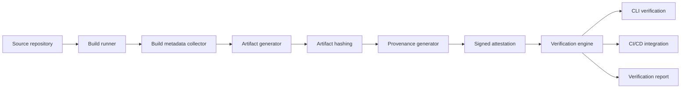

# BuildTrace

> An open-source build provenance and artifact verification system.


[](LICENSE)


**Status: skeleton (v0.0.0).** This repository contains the project structure, architecture decisions and
an implementation plan. **Nothing is functional yet.** The word "works" does not appear below unless it is
true.

## Why this exists

"We built this binary from that commit" is a claim, not evidence. Provenance only means anything
if someone else can verify it independently: the artifact digest, the inputs, and the identity that
attested to them. BuildTrace generates that evidence and, more importantly, verifies it.

## What it will do

| Capability | Milestone | Status |
|---|---|---|
| Capture source commit and build metadata | M1 | Not started |
| Record build environment | M1 | Not started |
| Generate provenance attestations | M3 | Not started |
| Generate and verify artifact hashes | M2 | Not started |
| Track dependencies | M6 | Not started |
| Verify artifact signatures | M4 | Not started |
| CI/CD integration | M5 | Not started |
| SBOM support | M6 | Not started |
| Reproducibility checks | M6 | Not started |

## Architecture



Full reasoning, data model, API surface and failure behaviour are in [docs/PLAN.md](docs/PLAN.md).

## Engineering challenge

Making build provenance verifiable and trustworthy, not just generating a JSON file that
claims an artifact is authentic. Every field in an attestation must map to an input someone else can
recompute.

## Quickstart

Not runnable yet. The skeleton builds and prints its version:

```bash
make build
./bin/buildtrace version
```

Full local stack (build and test tooling) arrives with
milestone M1.

## Repository layout

| Path | Purpose |
|---|---|
| `cmd/buildtrace` | CLI: record, verify, inspect |
| `internal/metadata` | Git state, environment, toolchain capture |
| `internal/hashing` | Artifact hashing and manifest generation |
| `internal/attestation` | Statement and predicate construction |
| `internal/signing` | Sigstore keyless and local key signing |
| `internal/verify` | Signature and digest verification, policy checks |
| `internal/sbom` | CycloneDX generation (M6) |
| `pkg/intoto` | in-toto statement types, no external dependency needed to read them |
| `tests/fixtures` | Committed artifacts for offline verification tests |

## Roadmap

| Milestone | Deliverable | Status |
|---|---|---|
| M1 | Build metadata collection and manifest generation | Not started |
| M2 | Artifact hashing and manifest verification | Not started |
| M3 | in-toto provenance generation | Not started |
| M4 | Signing and verification | Not started |
| M5 | GitHub Actions integration | Not started |
| M6 | SBOM support and reproducibility checks | Not started |

This roadmap mirrors [docs/PLAN.md](docs/PLAN.md) section 12. If the two disagree, the plan is correct and
the README is a bug.

## Project standards

- Conventional Commits, Semantic Versioning, `main` is always green.
- Every release is produced by CI, never by a laptop.
- Status claims must match reality. Unbuilt features are marked "Not started", not "coming soon".
- Decisions are recorded as ADRs in [docs/adr/](docs/adr/).

## Contributing

Read [CONTRIBUTING.md](CONTRIBUTING.md) and [docs/PLAN.md](docs/PLAN.md) first. Issues labelled
`good first issue` are scoped for a first pull request.

## Using an AI assistant on this repository

Read [docs/PLAN.md](docs/PLAN.md) end to end, including the machine context block at the top. It states
what exists, what does not, and which claims are forbidden. Do not describe planned behaviour as
implemented behaviour.

## License

Apache License 2.0 - see [LICENSE](LICENSE).
