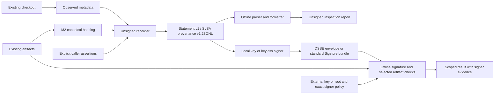

# BuildTrace

> An open-source build provenance and artifact verification system.


[](LICENSE)


**Status: M4 implemented and verified locally on `feat/m4-implementation`, source `6ef2dd9`.**
M1–M3 remain merged. M4 adds local Ed25519/P-256 signing, a standard keyless Sigstore bundle and
offline signature/identity/selected-artifact checks. Native Windows race, lint, schemas, audits,
memory and network-disabled container gates passed. **Final GitHub cross-platform CI and live
keyless signing are pending publication; the M4 branch is unmerged.** No release is claimed.
The default `record --sign none`, unsigned `inspect`, and M2 manifest contracts remain compatible.

## Why this exists

"We built this binary from that commit" is a claim. BuildTrace records recomputable artifact digests
and identifies which metadata was observed and which was supplied by the caller. M2 compares artifact
bytes with an unsigned manifest; M4 authenticates signed statements under an external signer policy.

## What it does today

| Capability | Milestone | Status |
|---|---|---|
| Capture source commit, dirty state and remote URI | M1 | **Done** |
| Record the build environment (builder, OS, toolchain) | M1 | **Done** |
| Write a deterministic `buildtrace.json` | M1 | **Done** |
| Strip credentials from the recorded remote | M1 | **Done** |
| Generate and verify artifact hashes | M2 | **Done (merged)** |
| Record and inspect unsigned in-toto/SLSA provenance | M3 | **Done (merged)** |
| Local signing and offline signature/artifact policy | M4 | **Implemented; local gates passed** |
| Keyless signing with complete offline bundle | M4 | **Implemented; real GitHub signing/CI pending** |
| CI/CD integration | M5 | Not started |
| Track dependencies | M6 | Not started |
| SBOM support | M6 | Not started |
| Reproducibility checks | M6 | Not started |

## What this release does **not** prove

This section is the most important one in this README, and it is reproduced from
[docs/PLAN.md](docs/PLAN.md) section 9.2. It changes only when that section changes.

- **M2 manifests and `record --sign none` statements are unsigned.** Anyone can edit artifacts and their expected digests.
  Matching a manifest or inspecting a statement does not authenticate the build or its source.
- **Recording and signing do not witness the original build.** Checkout state and tool versions are observed
  during recording. Explicit source and original-build time inputs remain caller assertions.
- **Inspection does not verify artifacts or signatures.** It parses bounded JSONL and reports
  `scope: unsigned_statement`, `status: inspected`; it does not open subjects or compare their bytes.
- **A builder label is not an authenticated identity.** `builder.id` is a public recorder label.
  M4 authenticates an external public key or certificate signer; `--expect-builder` is a separate assertion filter.
- **Artifact safety is not established.** No vulnerability or malware analysis is performed.
- **Reproducibility is not established.** No two-build comparison is performed; that verdict remains M6.
- **Dependency completeness is not established.** M3 can record one explicitly asserted source
  dependency; it does not discover the module graph, generate an SBOM or infer a workflow.
- **Offline trust freshness is not established.** Verification consumes an externally provisioned root snapshot;
  it cannot discover later compromise/revocation or prove global log consistency.
- **Format compatibility is not a SLSA level.** Schema checks and deterministic output do not
  authenticate build honesty, builder identity or compliance.

## Architecture



Full reasoning, data model, API surface and failure behaviour are in [docs/PLAN.md](docs/PLAN.md).
The shape of what exists today is in [docs/ARCHITECTURE.md](docs/ARCHITECTURE.md).

## Engineering challenge

Each field must map to a defined input. Artifact digests can be independently recomputed; checkout
observations can be compared with a checkout; caller assertions need separate evidence.

## Quickstart

Use Go 1.26.11 and `git`. The repository pins the patched toolchain.

```bash
make build
./bin/buildtrace version
```

Write a manifest for the artifacts of the current repository:

```bash
./bin/buildtrace manifest \
  --artifact dist/app \
  --artifact dist/app.sig \
  --out buildtrace.json
```

Historical M1 output, before hashing was implemented:

```json
{
  "schemaVersion": 1,
  "builtAt": "2026-11-13T05:10:21Z",
  "source": {
    "uri": "",
    "commit": "0e515c049e50c27cd85a388e2809c5df737fafee",
    "dirty": false
  },
  "builder": {
    "id": "local",
    "host": "Buddy",
    "os": "windows",
    "arch": "amd64"
  },
  "toolchain": {
    "go": "1.27.4",
    "git": "2.53.0.windows.2"
  },
  "artifacts": [
    {
      "name": "app",
      "path": "dist/app",
      "size": 18432112
    }
  ]
}
```

The empty `uri` is honest: this manifest was produced before the repository was published, so there
was no remote to record. A repository with a remote records it in the `git+` form, for example
`git+https://github.com/shellghostt/buildtrace`, with any credentials removed.

M2 adds `kind` and `digest` to each artifact. For a file containing exactly `hello`:

```json
{"kind":"file","name":"app","path":"dist/app","size":5,"digest":{"sha256":"2cf24dba5fb0a30e26e83b2ac5b9e29e1b161e5c1fa7425e73043362938b9824"}}
```

Verify from the repository root, or specify the artifact base directory:

```sh
./bin/buildtrace verify --manifest buildtrace.json --root . --json
```

```json
{"scope":"unsigned_manifest","status":"matched","verified":2}
```

Verification needs neither git nor network access. Relative artifact paths resolve from `--root`
(default current directory), regardless of where the manifest is saved. Paths outside the source
repository remain absolute and host-specific. M1 manifests without digests are rejected; regenerate
them with M2. Keep manifest output outside selected directory artifacts and stop writers during hashing.
The [canonical hashing contract](docs/adr/0004-m2-canonical-hashing-and-verification.md) defines directory
and symlink bytes, including empty directories and a 100,000-entry bound.

### Unsigned recording and inspection

```sh
./bin/buildtrace record --artifact dist/app --out app.intoto.jsonl --sign none
./bin/buildtrace inspect --attestation app.intoto.jsonl
./bin/buildtrace inspect --attestation app.intoto.jsonl --json
```

The unsigned default is `--sign none`. Unsigned/local recording needs git and existing
artifacts within the repository root, but does not run a build or fetch anything from the network.
Explicit keyless signing contacts its configured OIDC/Fulcio/Rekor services.
Subjects use unique repository-relative names and M2 digests. Keep output outside selected artifacts
and stop writers during hashing.

Inspection needs neither git nor the original artifacts. Its JSON report includes
`scope: unsigned_statement`, `status: inspected`, the parsed summary and the original `statement`,
including compatible unknown fields. Unknown statement/predicate URIs fail; an unknown build type is
displayed without interpreting its semantics.

| Record flag | Default or requirement | Meaning |
|---|---|---|
| `--artifact` | required, repeatable; 1–1,000 | Existing file, directory or terminal symlink within the checkout root. |
| `--repo` / `--out` | `.` / stdout | Checkout to observe and atomic JSONL destination. |
| `--sign` | `none` | `none` keeps M3 JSONL; `local` emits DSSE; `keyless` emits a standard v0.3 Sigstore bundle. |
| `--trusted-root` | keyless only, required | External pre-provisioned Sigstore root used to validate complete signing material. |
| `--builder-id` | BuildTrace `#local-recorder` URI | Public recorder label; HTTP(S) URI or opaque URN. |
| `--invocation-id` | Canonical statement SHA-256 | Public explicit ID, or `sha256:<hex>` derived with that field omitted. |
| `--source-uri` / `--source-commit` | paired optional inputs | Asserted original source and full 40- or 64-digit commit, labeled `caller_assertion`. |
| `--started-on` / `--finished-on` | paired optional RFC 3339 inputs | Asserted original-build times, normalized to UTC with precision preserved. |

Original build times are omitted unless explicitly supplied. Neither the clock nor `SOURCE_DATE_EPOCH`
populates them. Equal artifact bytes, checkout/recorder metadata, IDs and time claims yield identical
compact JSONL; pinning times alone does not make different hosts or toolchains identical.
URI credentials, queries and fragments are removed; no hostname, host root or environment dump is
emitted. Explicit IDs and URI paths must contain public metadata.

The [versioned recorder contract](docs/build-types/record/v1.md) defines every field and parsing limit.
The two [synthetic fixtures](tests/fixtures/m3/README.md) show observations alone and explicit claims.

### Local signing and offline verification

Set `BUILDTRACE_SIGNING_KEY` to a private file path; never put key bytes/passphrases in CLI arguments.
Support one unencrypted PKCS#8 Ed25519/P-256 or SEC1 P-256 PEM key. Keep it outside selected artifacts
and outputs, restrict POSIX permissions to its owner, and restrict its Windows ACL. The consumer
obtains the trusted PKIX public-key file independently of the attestation.

```sh
export BUILDTRACE_SIGNING_KEY=/secure/private.pem
./bin/buildtrace record --artifact dist/app --sign local --out app.dsse.json
./bin/buildtrace verify --attestation app.dsse.json --artifact dist/app --root . \
  --public-key /trusted/public.pem --json
```

In PowerShell, use `$env:BUILDTRACE_SIGNING_KEY='C:\secure\private.pem'`. Local signing/verification
needs no network. Verification executes no git command and authenticates exact payload bytes before
interpreting claims. The JSON report has `scope: signed_statement`, `status: verified`, actual signer
evidence, every selected check and unselected subject names. A failed artifact check remains `failed`
even when the signer was authenticated.

Artifacts must be explicit relative paths under `--root`. For a relocated artifact, supply one
`--subject <original-canonical-name>` per selected artifact, in matching order. No path or URL inside
an attestation selects a file to open. `--expect-builder` separately constrains the signed recorder
label; paired `--expect-source-uri` / `--expect-source-commit` compare a declared source claim.

### Keyless signing and historical offline verification

Provision a root snapshot separately using authenticated public-good TUF:

```sh
make VERSION=m4-local trust-setup TRUST_ROOT=trusted-root.json
```

The setup tool reports its SHA-256. Protect/pin that independently trusted snapshot; bundle certificates,
keys and URLs do not provide trust. In an authorized GitHub Actions runner with `id-token: write`,
`record --artifact dist/app --sign keyless --trusted-root trusted-root.json --out app.sigstore.json` obtains the OIDC token
in process. A separately supplied bounded private `BUILDTRACE_OIDC_TOKEN_FILE` is also supported.
Neither token nor ephemeral private key is written to the attestation or git environment.
The focused M4 live CI check is prepared but has **not run before publication**.

Consumers supply exact certificate identity and issuer from their policy:

```sh
./bin/buildtrace verify --attestation app.sigstore.json --artifact dist/app --root . \
  --trusted-root trusted-root.json \
  --expect-identity 'https://github.com/OWNER/REPO/.github/workflows/ci.yml@refs/heads/main' \
  --expect-issuer 'https://token.actions.githubusercontent.com' --json
```

Expected identity/issuer match literally, without regex or URL normalization. Offline verification
requires a bound Rekor v1 SET, inclusion proof/signed checkpoint, trusted chain/CT signature and exact
signer policy. It checks certificate validity at authenticated signing time, allowing a valid historical
signature after leaf expiry. It performs no online root/log lookup. Missing or invalid evidence fails.

M4 accepts one signature, DSSE payload type `application/vnd.in-toto+json`, standard Sigstore bundle
v0.3 and trusted-root v0.1. Outer/decoded limits are 32/16 MiB with separate key/certificate/proof/token/
depth bounds. [Accepted policy and limits](docs/adr/0006-m4-signing-and-offline-verification.md),
[audited pins](docs/adr/0007-m4-audited-dependency-pins.md), [resolved protobuf patch](docs/adr/0008-m4-resolved-protobuf-patch.md)
and [module/license inventory](docs/dependencies/m4-signing.json) document the exact stack.

Explicit `verify --allow-unsigned` supports selected digest/kind/size comparison only without signer
policy. Its result is `unsigned_statement / matched`, `authenticated: false`, with a warning. It
cannot satisfy a public-key/identity/issuer policy, and no failed signed check falls back to it.

### Container image

`docker build -t buildtrace:local .` builds the static CLI in an Alpine runtime that includes `git`
for manifest capture and runs as UID/GID 65532. Files used for capture must be readable by that user,
and an output directory must be writable. For verification, mount the manifest and artifacts read-only:

```bash
docker run --rm --network none --read-only \
  --mount "type=bind,src=$(pwd),target=/work,readonly" \
  buildtrace:local verify --manifest /work/buildtrace.json --root /work --json
```

`bash tests/container/smoke.sh buildtrace:local` checks M2/M3 contracts plus local and historical
keyless M4 verification, explicit unsigned scope, exact identity and artifact tampering.
The test uses temporary container memory, with network disabled and a read-only root filesystem.
The CI workflow defines the same check.

### Manifest flags

| Flag | Default | Meaning |
|---|---|---|
| `--artifact` | required, repeatable | A file, directory or terminal symlink the build produced. |
| `--out` | stdout | Where to write the manifest. |
| `--repo` | `.` | The repository the build came from. Must be inside a git repository. |
| `--built-at` | now | The build timestamp, RFC 3339. Overrides `SOURCE_DATE_EPOCH`. |
| `--builder-id` | `local` | A builder label; no identity is authenticated. |

The M2 manifest timestamp can also be pinned with `SOURCE_DATE_EPOCH`. With all metadata and artifact
inputs equal, including that timestamp, two runs produce byte-identical manifests. M3 uses the
separate original-build time claim policy described above.

### Exit codes

| Code | Meaning |
|---|---|
| 0 | Output written/inspected, unsigned artifacts matched, or complete signed policy/artifact verification succeeded. |
| 1 | Verification mismatch: signature/trust/time/identity/subject/digest/kind/size/assertion policy failed. |
| 2 | Invalid input, missing artifact, unsupported format/signing mode or malformed/bounded-out JSONL. |
| 3 | Tool or I/O error, including unreadable input and unwritable output. |

M4 JSON failures use stable reasons and one document. The [reason/exit contract](docs/adr/0006-m4-signing-and-offline-verification.md)
and [validation](docs/testing/m4-signing.md) cover each case. M3 generation/inspection remains an
unsigned observation/inspection, with no artifact or signer verification verdict.

## Repository layout

| Path | Purpose |
|---|---|
| `cmd/buildtrace` | The entry point: a thin wrapper around `internal/cli` |
| `internal/cli` | The commands and their exit codes |
| `internal/metadata` | Git state, toolchain and platform capture |
| `internal/manifest` | The `buildtrace.json` model, serialiser and artifact collection |
| `internal/testrepo` | Throwaway git repositories for the tests |
| `internal/hashing` | Artifact hashing and directory determinism (M2) |
| `internal/attestation` | M3 artifact observations, statement construction and bounded offline inspection |
| `internal/signing` | Sigstore keyless and local key signing (M4) |
| `internal/verify` | Unchanged M2 manifest checks and M4 rooted signed/explicit unsigned statement policy |
| `internal/sbom` | CycloneDX generation (M6) |
| `pkg/intoto` | in-toto statement types, no external dependency needed to read them (M3) |
| `tests/fixtures/m3` | Two synthetic unsigned provenance goldens |
| `tests/fixtures/m4` | Public local/historical keyless interoperability fixtures and their checksums |
| `tests/schemas` | Isolated pinned upstream validators; no CLI runtime dependency |

## Roadmap

M3 is **complete and merged** through [PR #2](https://github.com/Shellghostt/BuildTrace/pull/2), with successful
[main CI](https://github.com/Shellghostt/BuildTrace/actions/runs/44006031195). Read the
[acceptance evidence](docs/testing/m3-provenance.md) and [phase contract](docs/phases/M3.md).
[M4 requirements](docs/phases/M4.md), [validation](docs/testing/m4-signing.md) and
[resource measurements](docs/benchmarks/m4-signing.md) record implemented source `6ef2dd9` and passing
local gates. **Final cross-platform and real authorized keyless CI are pending publication.** The
branch is local/unmerged; M5 reusable action/release and M6 SBOM/reproducibility remain future work.

| Milestone | Deliverable | Status |
|---|---|---|
| M1 | Build metadata collection and manifest generation | **Done** (v0.1.0) |
| M2 | Artifact hashing and manifest verification | **Done (merged)** |
| M3 | Unsigned in-toto/SLSA record and inspect | **Done (merged)** |
| M4 | Signing and verification | Implemented; local gates passed, final/live CI pending |
| M5 | GitHub Actions integration | Not started |
| M6 | SBOM support and reproducibility checks | Not started |

This roadmap mirrors [docs/PLAN.md](docs/PLAN.md) section 12. If the two disagree, the plan is correct and
the README is a bug.

## Testing

```bash
make test
make race
make lint
make memory-gate  # Windows/PowerShell: 1 GiB manifest, verify, record and memory gate
make schema-setup
GOTOOLCHAIN=local GOPROXY=off GOSUMDB=off make schemas
```

The unit tests use a real `git` binary against a throwaway repository in a temporary directory, so
they exercise the actual behaviour of the collector rather than a mock of it. The legacy M1 manifest
format is covered by a golden file, which can be regenerated explicitly:

```bash
BUILDTRACE_WRITE_GOLDEN=1 go test ./internal/manifest -run TestWriteTheGoldenFile
```

M2 adds the same independently computed directory golden on Windows and Linux, actual CLI offline
verification, malformed-input and tamper tests. The 1 GiB run measured 44.04 MiB peak working set
for capture and 7.61 MiB for verification. Method and limits are in the
[validation report](docs/testing/m1-m2-validation.md).

M3 adds two byte-for-byte goldens, isolated offline upstream format checks, strict bounded JSONL
tests and real CLI/container record/inspect checks. Native Windows `make race` now passes with a
64-bit MSYS2 UCRT64 compiler. The final 1 GiB recording run used 9.09 MiB peak working set, below the
64 MiB gate. Commands, test mapping, schema pins and limitations are in
[M3 validation](docs/testing/m3-provenance.md) and [memory/profiling evidence](docs/benchmarks/m3-provenance.md).
M4 adds exact-byte signing, historical trust/time/proof tests, selected artifact scope, independent
signed fixtures and resource/dependency evidence in [M4 validation](docs/testing/m4-signing.md).
On Windows, use `VERSION=m4-local` with Make targets to bypass the existing Unix version-discovery
expression, and use the pinned compiler/offline setup documented in those reports.

## Project standards

- Conventional Commits, Semantic Versioning, `main` is always green.
- Every release is produced by CI, never by a laptop.
- Status claims must match reality. Unbuilt features are marked "Not started", not "coming soon".
- Decisions are recorded as ADRs in [docs/adr/](docs/adr/).

## Contributing

Read [CONTRIBUTING.md](CONTRIBUTING.md) and [docs/PLAN.md](docs/PLAN.md) first. Issues labelled
`good first issue` are scoped for a first pull request.

## Using an AI assistant on this repository

Read [docs/PLAN.md](docs/PLAN.md) end to end, including the machine context block at the top. It states
what exists, what does not, and which claims are forbidden. Do not describe planned behaviour as
implemented behaviour.

## License

Apache License 2.0 - see [LICENSE](LICENSE).
