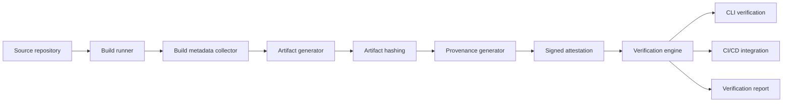

# BuildTrace

> An open-source build provenance and artifact verification system.


[](LICENSE)


**Status: M2 implemented on the feature branch (unreleased).** BuildTrace records build metadata
and SHA-256 digests for files, directories and symlinks in a deterministic `buildtrace.json`.
`verify --manifest` recomputes artifact kinds, digests and sizes offline. A match establishes
consistency with the supplied unsigned manifest. Signatures and builder identity are not checked.

## Why this exists

"We built this binary from that commit" is a claim, not evidence. Provenance only means anything
if someone else can verify it independently: the artifact digest, the inputs, and the identity that
attested to them. BuildTrace generates that evidence and, more importantly, verifies it.

## What it does today

| Capability | Milestone | Status |
|---|---|---|
| Capture source commit, dirty state and remote URI | M1 | **Done** |
| Record the build environment (builder, OS, toolchain) | M1 | **Done** |
| Write a deterministic `buildtrace.json` | M1 | **Done** |
| Strip credentials from the recorded remote | M1 | **Done** |
| Generate and verify artifact hashes | M2 | **Done**, unreleased |
| Generate provenance attestations (in-toto, SLSA) | M3 | Not started |
| Verify artifact signatures | M4 | Not started |
| CI/CD integration | M5 | Not started |
| Track dependencies | M6 | Not started |
| SBOM support | M6 | Not started |
| Reproducibility checks | M6 | Not started |

## What this release does **not** prove

This section is the most important one in this README, and it is reproduced from
[docs/PLAN.md](docs/PLAN.md) section 9.2. It changes only when that section changes.

- **The manifest is unsigned.** Anyone can edit both an artifact and its expected digest. A match
  alone does not authenticate the build or its source commit.
- **It does not prove the artifact is safe or trustworthy.** Nothing analyses its contents.
- **It does not prove the build was reproducible.** Two builds of the same commit may differ, and
  nothing in this release compares them.
- **It does not attest to who built it.** The `builder.id` is whatever the caller passed on the command
  line. It is a label, not an identity.
- **It does not attest to the build's dependencies.** Nothing is recorded about the module graph.
- **It is not a signature.** The manifest is plain JSON and can be edited by anyone.

## Architecture



Full reasoning, data model, API surface and failure behaviour are in [docs/PLAN.md](docs/PLAN.md).
The shape of what exists today is in [docs/ARCHITECTURE.md](docs/ARCHITECTURE.md).

## Engineering challenge

Making build provenance verifiable and trustworthy, not just generating a JSON file that
claims an artifact is authentic. Every field in an attestation must map to an input someone else can
recompute.

## Quickstart

Requires Go 1.26+ and `git`.

```bash
make build
./bin/buildtrace version
```

Write a manifest for the artifacts of the current repository:

```bash
./bin/buildtrace manifest \
  --artifact dist/app \
  --artifact dist/app.sig \
  --out buildtrace.json
```

Historical M1 output, before hashing was implemented:

```json
{
  "schemaVersion": 1,
  "builtAt": "2026-11-13T05:10:21Z",
  "source": {
    "uri": "",
    "commit": "0e515c049e50c27cd85a388e2809c5df737fafee",
    "dirty": false
  },
  "builder": {
    "id": "local",
    "host": "Buddy",
    "os": "windows",
    "arch": "amd64"
  },
  "toolchain": {
    "go": "1.27.4",
    "git": "2.53.0.windows.2"
  },
  "artifacts": [
    {
      "name": "app",
      "path": "dist/app",
      "size": 18432112
    }
  ]
}
```

The empty `uri` is honest: this manifest was produced before the repository was published, so there
was no remote to record. A repository with a remote records it in the `git+` form, for example
`git+https://github.com/shellghostt/buildtrace`, with any credentials removed.

M2 adds `kind` and `digest` to each artifact. For a file containing exactly `hello`:

```json
{"kind":"file","name":"app","path":"dist/app","size":5,"digest":{"sha256":"2cf24dba5fb0a30e26e83b2ac5b9e29e1b161e5c1fa7425e73043362938b9824"}}
```

Verify from the repository root, or specify the artifact base directory:

```sh
./bin/buildtrace verify --manifest buildtrace.json --root . --json
```

```json
{"scope":"unsigned_manifest","status":"matched","verified":2}
```

Verification needs neither git nor network access. Relative artifact paths resolve from `--root`
(default current directory), regardless of where the manifest is saved. Paths outside the source
repository remain absolute and host-specific. M1 manifests without digests are rejected; regenerate
them with M2. Keep manifest output outside selected directory artifacts and stop writers during hashing.
The [canonical hashing contract](docs/adr/0004-m2-canonical-hashing-and-verification.md) defines directory
and symlink bytes, including empty directories and a 100,000-entry bound.

### Container image

`docker build -t buildtrace:local .` builds the static CLI in an Alpine runtime that includes `git`
for manifest capture and runs as UID/GID 65532. Files used for capture must be readable by that user,
and an output directory must be writable. For verification, mount the manifest and artifacts read-only:

```bash
docker run --rm --network none --read-only \
  --mount "type=bind,src=$(pwd),target=/work,readonly" \
  buildtrace:local verify --manifest /work/buildtrace.json --root /work --json
```

`bash tests/container/smoke.sh buildtrace:local` checks capture, deterministic hashing, offline
verification and the negative exit codes using temporary container memory only. CI runs the same check.

### Flags

| Flag | Default | Meaning |
|---|---|---|
| `--artifact` | required, repeatable | A file, directory or terminal symlink the build produced. |
| `--out` | stdout | Where to write the manifest. |
| `--repo` | `.` | The repository the build came from. Must be inside a git repository. |
| `--built-at` | now | The build timestamp, RFC 3339. Overrides `SOURCE_DATE_EPOCH`. |
| `--builder-id` | `local` | The identity of the builder. This is a label, not an attestation. |

The build timestamp can also be pinned with the `SOURCE_DATE_EPOCH` environment variable, which is the
convention reproducible-build tooling uses. With the timestamp pinned, two runs over the same inputs
produce byte-identical manifests.

### Exit codes

| Code | Meaning |
|---|---|
| 0 | Manifest written, or artifacts match the unsigned manifest. |
| 1 | Verification mismatch: `digest_mismatch`, `kind_mismatch` or `size_mismatch`. |
| 2 | Invalid input, missing artifact, malformed manifest or unsupported schema version. |
| 3 | Tool error: an unwritable output file, or a command that is not implemented yet. |

`record` and `inspect`, and verification of signed attestations, remain later milestones.

## Repository layout

| Path | Purpose |
|---|---|
| `cmd/buildtrace` | The entry point: a thin wrapper around `internal/cli` |
| `internal/cli` | The commands and their exit codes |
| `internal/metadata` | Git state, toolchain and platform capture |
| `internal/manifest` | The `buildtrace.json` model, serialiser and artifact collection |
| `internal/testrepo` | Throwaway git repositories for the tests |
| `internal/hashing` | Artifact hashing and directory determinism (M2) |
| `internal/attestation` | Statement and predicate construction (M3) |
| `internal/signing` | Sigstore keyless and local key signing (M4) |
| `internal/verify` | Unsigned manifest comparison (M2); signature and policy checks remain M4 |
| `internal/sbom` | CycloneDX generation (M6) |
| `pkg/intoto` | in-toto statement types, no external dependency needed to read them (M3) |
| `tests/fixtures` | Committed artifacts for offline verification tests (M4) |

## Roadmap

| Milestone | Deliverable | Status |
|---|---|---|
| M1 | Build metadata collection and manifest generation | **Done** (v0.1.0) |
| M2 | Artifact hashing and manifest verification | **Done**, unreleased |
| M3 | in-toto provenance generation | Not started |
| M4 | Signing and verification | Not started |
| M5 | GitHub Actions integration | Not started |
| M6 | SBOM support and reproducibility checks | Not started |

This roadmap mirrors [docs/PLAN.md](docs/PLAN.md) section 12. If the two disagree, the plan is correct and
the README is a bug.

## Testing

```bash
make test
make race
make memory-gate  # Windows/PowerShell: 1 GiB capture, verify, tamper and memory gate
```

The unit tests use a real `git` binary against a throwaway repository in a temporary directory, so
they exercise the actual behaviour of the collector rather than a mock of it. The legacy M1 manifest
format is covered by a golden file, which can be regenerated explicitly:

```bash
BUILDTRACE_WRITE_GOLDEN=1 go test ./internal/manifest -run TestWriteTheGoldenFile
```

M2 adds the same independently computed directory golden on Windows and Linux, actual CLI offline
verification, malformed-input and tamper tests. The 1 GiB run measured 44.04 MiB peak working set
for capture and 7.61 MiB for verification. Method and limits are in the
[validation report](docs/testing/m1-m2-validation.md).

## Project standards

- Conventional Commits, Semantic Versioning, `main` is always green.
- Every release is produced by CI, never by a laptop.
- Status claims must match reality. Unbuilt features are marked "Not started", not "coming soon".
- Decisions are recorded as ADRs in [docs/adr/](docs/adr/).

## Contributing

Read [CONTRIBUTING.md](CONTRIBUTING.md) and [docs/PLAN.md](docs/PLAN.md) first. Issues labelled
`good first issue` are scoped for a first pull request.

## Using an AI assistant on this repository

Read [docs/PLAN.md](docs/PLAN.md) end to end, including the machine context block at the top. It states
what exists, what does not, and which claims are forbidden. Do not describe planned behaviour as
implemented behaviour.

## License

Apache License 2.0 - see [LICENSE](LICENSE).
