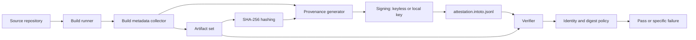
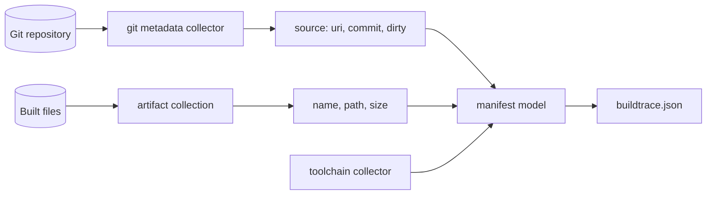

# BuildTrace Architecture

**Status: partially implemented (M1).** The metadata collectors, the manifest model and the `manifest`
command exist and are tested against a real `git` binary. The hasher, the provenance generator, the
signer, the verifier and the SBOM generator do not exist yet. The authoritative specification is
[PLAN.md](PLAN.md), and section 0 there is the current truth.

## Context

An open-source build provenance and artifact verification system.

"We built this binary from that commit" is a claim, not evidence. Provenance only means anything
if someone else can verify it independently: the artifact digest, the inputs, and the identity that
attested to them. BuildTrace generates that evidence and, more importantly, verifies it.

## Shape

## What exists today

| Package | Responsibility |
|---|---|
| `internal/metadata` | The facts about a build: the commit, the dirty state, the normalised remote, the Go and git versions, the platform. An allowlist decides what is read; the environment is never dumped. |
| `internal/manifest` | The `buildtrace.json` format: the model, the deterministic serialiser, the artifact collection. The digest field exists in the model but is omitted in M1, because hashing is M2. |
| `internal/cli` | The commands and their exit codes. It exists so that the exit codes and the output can be tested. |
| `cmd/buildtrace` | A thin entry point that wires the standard streams into `internal/cli` and turns the returned code into a process exit code. |

## Data path

1. The caller names the artifacts and the repository.
2. The git collector asks `git` for the top level, for `HEAD`, for the working tree status and for the
   remote. It runs `git` with an allowlisted environment and no shell.
3. The remote is normalised to a `git+` URI and its credentials are removed.
4. The artifact collector resolves each path relative to the repository root and records its name, its
   relative path and its size.
5. The manifest is serialised: the artifacts are sorted by path, the field order is the struct order,
   the indentation is two spaces, and the timestamp is truncated to the second in UTC.

The manifest is deterministic: the same repository, the same artifacts and the same declared timestamp
produce the same bytes.

## Failure behaviour

| Failure | What happens |
|---|---|
| The directory is not inside a git repository | Exit 2, with a message that names the directory. |
| The repository has no commits yet | Exit 2, with a message that says so. |
| An artifact does not exist | Exit 2, naming the artifact. |
| An artifact is a directory | Exit 2, with a message that says when directories are supported. |
| The build timestamp is not RFC 3339 | Exit 2, explaining the expected format. |
| The output file cannot be written | Exit 3. |
| `record`, `verify` or `inspect` is called | Exit 3, saying the command is planned for a later milestone. |
| The working tree is dirty | Not a failure. `dirty: true` is recorded and a warning goes to stderr. |
| `git` is not installed | The source is unavailable, so the command fails. The Go version is still known. |

## Secret handling

A manifest gets uploaded, committed and attached to releases. Three rules follow from that:

- The collector reads named fields. It never dumps the environment.
- The `git` subprocess gets an allowlisted environment, so a credential in the environment of
  BuildTrace is not reachable from git.
- The one input where a credential can appear by accident is the remote URL, and its userinfo is
  removed before the URI is recorded.

The secret-exclusion test plants a fake token in the remote URL, in `GITHUB_TOKEN`, in `NPM_TOKEN`, in
`AWS_SECRET_ACCESS_KEY` and in the builder id, and asserts that it appears nowhere in the manifest, in
stdout or in stderr.

## Component responsibilities

See [PLAN.md](PLAN.md) section 6 for the responsibility of each box, the request and event flows, and the
failure behaviour of each stage.

## What is deliberately absent

See [PLAN.md](PLAN.md) section 4 (non-goals). If a component is not on that diagram, it is not part of the
design.
