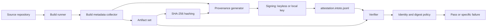
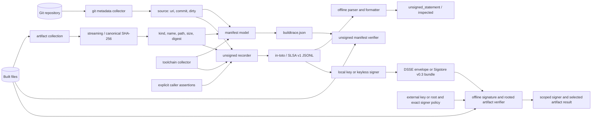

# BuildTrace Architecture

**Status: M1–M3 merged; M4 complete and locally/CI verified on `feat/m4-implementation`, source `91a11df`.**
Unsigned provenance recording/inspection, metadata collectors, deterministic manifests, file/directory/
symlink hashing and offline unsigned manifest verification exist. M1–M3 Windows/Ubuntu/macOS CI passed.
The [merged main CI](https://github.com/Shellghostt/BuildTrace/actions/runs/44006031195) passed.
M4 local/keyless signing and offline signer/artifact policy exist with passing local gates.
All eight real/cross-platform source CI jobs passed; PR #3 is published/unmerged.
Dependency discovery and SBOM remain later milestones.
The authoritative specification is
[PLAN.md](PLAN.md), and section 0 there is the current truth.

## Context

An open-source build provenance and artifact verification system.

BuildTrace records independently recomputable artifact digests and defines the evidence behind its
metadata. Checkout observations and caller assertions do not authenticate the original build.
M2 compares artifacts with unsigned manifests; M3 inspection parses unsigned statements.

## Shape

This target diagram includes an external build runner and implemented M4 signing/identity components.
M3 does not execute arbitrary build commands.

## What exists today

| Package | Responsibility |
|---|---|
| `internal/metadata` | Observed checkout state and current recorder tool versions/platform. An allowlist decides what is read; the environment is never dumped. |
| `internal/manifest` | Format v1, deterministic serialization, hashed artifact collection and bounded strict reader. |
| `internal/hashing` | Raw file SHA-256 with a 1 MiB buffer; sorted canonical directory/symlink digests. |
| `internal/verify` | Unchanged M2 manifest checks plus M4 external signer policy, rooted selected artifact checks and explicit unsigned comparison. |
| `internal/signing` | Strict bounded DSSE/PAE/PEM and standard Sigstore bundles; explicit local key/root/identity policy, authenticated log time and configured keyless signing services. |
| `internal/attestation` | Collect relative artifact observations, construct the unsigned recorder predicate and parse bounded JSONL offline. |
| `pkg/intoto` | Standard-library-only Statement v1/SLSA provenance v1 wire types and compact serialization. |
| `internal/cli` | The commands and their exit codes. It exists so that the exit codes and the output can be tested. |
| `cmd/buildtrace` | A thin entry point that wires the standard streams into `internal/cli` and turns the returned code into a process exit code. |

## Data path

1. The caller names the artifacts and the repository.
2. The git collector asks `git` for the top level, for `HEAD`, for the working tree status and for the
   remote. It runs `git` with an allowlisted environment and no shell.
3. The remote is normalised to a `git+` URI and its credentials are removed.
4. The artifact collector resolves each path relative to the repository root and records its name, its
   relative path, kind, byte count and digest. Terminal symlinks and directory links are recorded
   without following them. Directory reads use `os.Root` and common concurrent changes are checked.
5. The manifest is serialised: the artifacts are sorted by path, the field order is the struct order,
   the indentation is two spaces, and the timestamp is truncated to the second in UTC.

The manifest is deterministic: the same repository, the same artifacts and the same declared timestamp
produce the same bytes.

Verification reads one manifest up to 16 MiB and rejects duplicate fields/paths, unknown fields and
unsupported versions. Relative paths resolve from `--root` (current directory by default). Digests and
declared sizes/kinds are recomputed; metadata labels are not authenticated. Directory contents stream,
while sorting keeps at most 100,000 entries. The byte format is specified in ADR 0004.

M3 `record` reuses these canonical digests, but requires selected artifacts within the checkout root.
It uses unique relative paths as subject names and emits no hostname, host root or environment dump.
The shared hasher resolves Windows file identity during observation, before a later replacement can
redirect a lazy identity lookup; canonical bytes and M2 formats are unchanged.

The recorder separates observed checkout/artifact/tool metadata from optional source and original-build
time assertions. It generates one compact LF-terminated statement, with a fixed field/array order and
an explicit ID or the canonical statement hash with invocationId omitted. It has no original-build
clock default, inferred dependencies/byproducts or authenticated builder identity.
See the [field contract](build-types/record/v1.md) and accepted ADR 0005.

M3 `inspect` reads exactly one LF/CRLF-terminated JSON line with 16 MiB, 64-level, 200,000-token and
1,000-entry resource bounds. It rejects duplicate keys and unsupported statement/predicate URIs.
Compatible unknown fields remain in the raw statement; an unknown build type has uninterpreted semantics.
It runs no commands and opens no artifact subjects. Success is `unsigned_statement / inspected`.

## Failure behaviour

| Failure | What happens |
|---|---|
| The directory is not inside a git repository | Exit 2, with a message that names the directory. |
| The repository has no commits yet | Exit 2, with a message that says so. |
| An artifact does not exist | Exit 2, naming the artifact. |
| Artifact bytes, kind or size disagree | Exit 1, naming the artifact and exact mismatch. |
| Malformed manifest or unsupported schema version | Exit 2; no guessed interpretation. |
| Artifact cannot be read during verification | Exit 3; missing artifacts specifically exit 2. |
| The build timestamp is not RFC 3339 | Exit 2, explaining the expected format. |
| The output file cannot be written | Exit 3. |
| Malformed/bounded-out JSONL or unsupported statement/predicate URI | Exit 2, without a guessed interpretation. |
| Unsupported signing mode or missing local/keyless policy | Exit 2 before signing; no unsigned fallback. |
| Recording detects a changed artifact | Exit 2, asking the caller to stop writers and retry. |
| Statement input cannot be read or output cannot be written | Exit 3; a missing input specifically exits 2. |
| The working tree is dirty | Not a failure. `dirty: true` is recorded and a warning goes to stderr. |
| `git` is not installed | The source is unavailable, so the command fails. The Go version is still known. |

## Secret handling

A manifest gets uploaded, committed and attached to releases. Three rules follow from that:

- The collector reads named fields. It never dumps the environment.
- The `git` subprocess gets an allowlisted environment, so a credential in the environment of
  BuildTrace is not reachable from git.
- The one input where a credential can appear by accident is the remote URL, and its userinfo is
  removed before the URI is recorded.

For M3, all network source/builder/invocation URI inputs also lose queries and fragments. Local source
remotes are omitted. Original-build assertions enter only through defined flags, and explicit public
IDs/URI paths remain the caller's responsibility. Inspection preserves its input statement; it is not
a redaction service or authenticity check.

The secret-exclusion test plants a fake token in the remote URL, in `GITHUB_TOKEN`, in `NPM_TOKEN`, in
`AWS_SECRET_ACCESS_KEY` and in the builder id, and asserts that it appears nowhere in the manifest, in
stdout or in stderr.

## Component responsibilities

See [PLAN.md](PLAN.md) section 6 for the responsibility of each box, the request and event flows, and the
failure behaviour of each stage.

## What is deliberately absent

See [PLAN.md](PLAN.md) section 3 (non-goals). If a component is not on that diagram, it is not part of the
design.

## M3 validation

Read [phase requirements](phases/M3.md), the [validation record](testing/m3-provenance.md) and
[memory/profile evidence](benchmarks/m3-provenance.md). Local M3 gates and GitHub CI passed, and
[PR #2](https://github.com/Shellghostt/BuildTrace/pull/2) is merged.
[Development tools](DEVELOPMENT-TOOLS.md) records actual coverage and limitations.

## M4 implemented scope

[M4 requirements](phases/M4.md), [validation](testing/m4-signing.md) and accepted ADRs 0006-0008 define
implemented DSSE/local/keyless modes and bounded offline policy. Local signing emits a DSSE envelope;
keyless signing emits one standard v0.3 bundle after external-root validation of complete offline material.
M3's payload bytes/LF/ID, M2 canonical digests and default unsigned paths remain unchanged.

The verifier takes an external public key or standard root snapshot plus exact certificate signer/issuer.
It verifies exact PAE bytes, SET-bound time, certificate/CT and log/checkpoint/proof binding, then selects
only caller-named rooted artifacts and recomputes digest/kind/count under the known recorder contract.
Unselected names and partial failures remain explicit. It fetches no URL, opens no attestation-selected
path, runs no git/build/OIDC/TUF command and never repairs a failure through unsigned/online fallback.

`builder.id` and optional source policy remain signed assertion constraints, not signer identity or
witnessed original build history. Offline roots require externally trusted provisioning/updates; later
revocation/compromise and global log consistency are outside the offline evidence. Root setup is an
opt-in bounded TUF tool, while keyless signing uses configured public-good OIDC/Fulcio/Rekor services.
The [81-module license/checksum inventory](dependencies/m4-signing.json) records the expanded runtime/tests.
Real authorized keyless signing and Windows/Ubuntu/macOS CI passed on source `91a11df`;
[structured evidence](testing/m4-ci-results.json) records the results. No merge/release is claimed.
