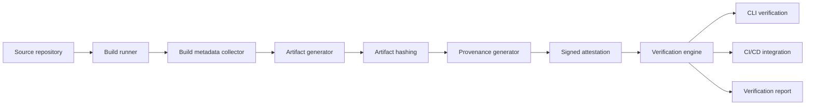

# BuildTrace Architecture

**Status: planned. No implementation exists yet.** This document describes intended structure, not
delivered behaviour. The authoritative specification is [PLAN.md](PLAN.md).

## Context

An open-source build provenance and artifact verification system.

"We built this binary from that commit" is a claim, not evidence. Provenance only means anything
if someone else can verify it independently: the artifact digest, the inputs, and the identity that
attested to them. BuildTrace generates that evidence and, more importantly, verifies it.

## Intended shape

## Component responsibilities

See [PLAN.md](PLAN.md) section 6 for the responsibility of each box, the request and event flows, and the
failure behaviour of each stage.

## What is deliberately absent

See [PLAN.md](PLAN.md) section 4 (non-goals). If a component is not on that diagram, it is not part of the
design.
